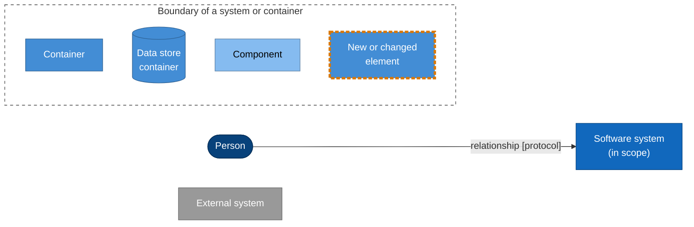
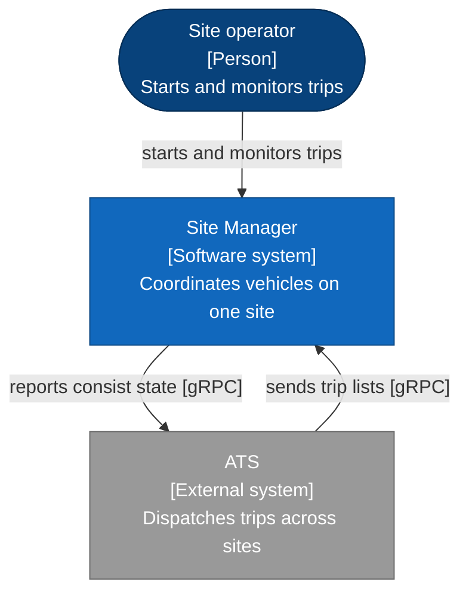
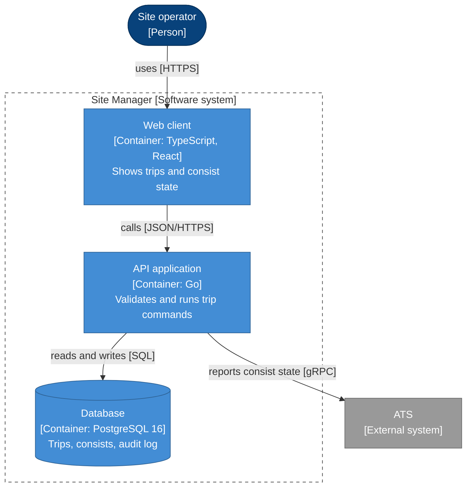
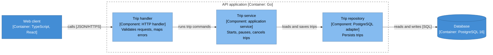
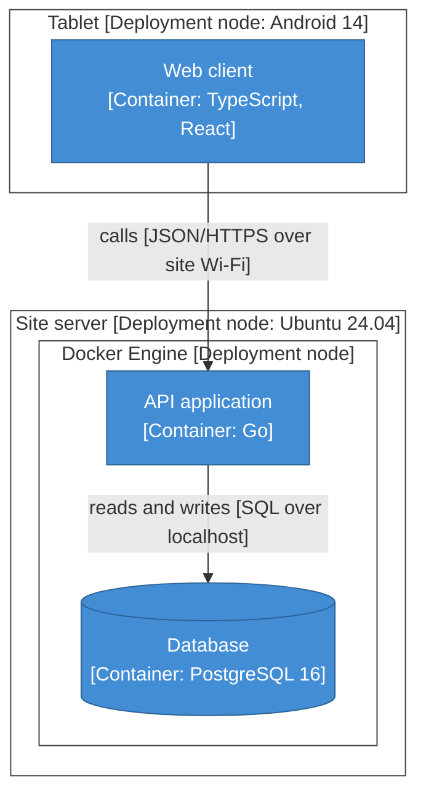
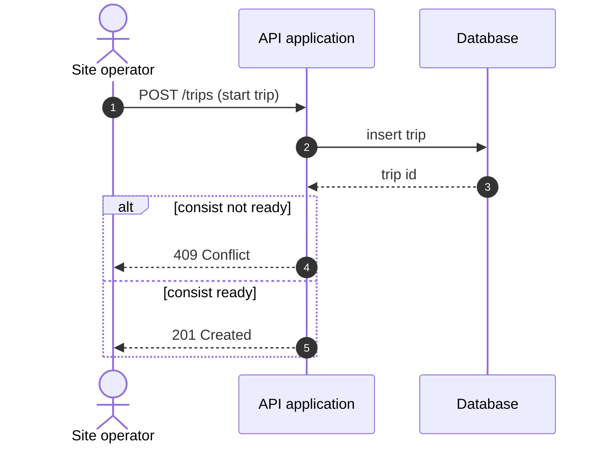
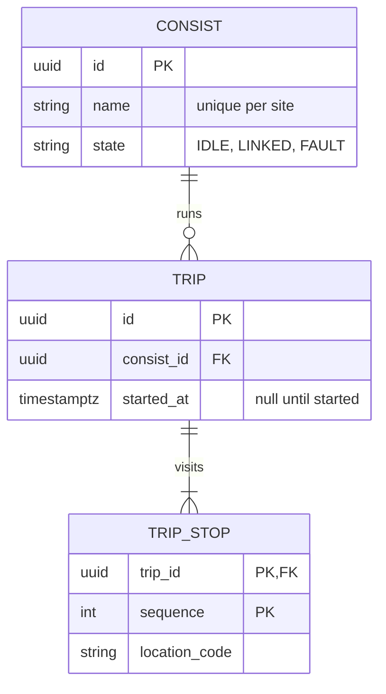
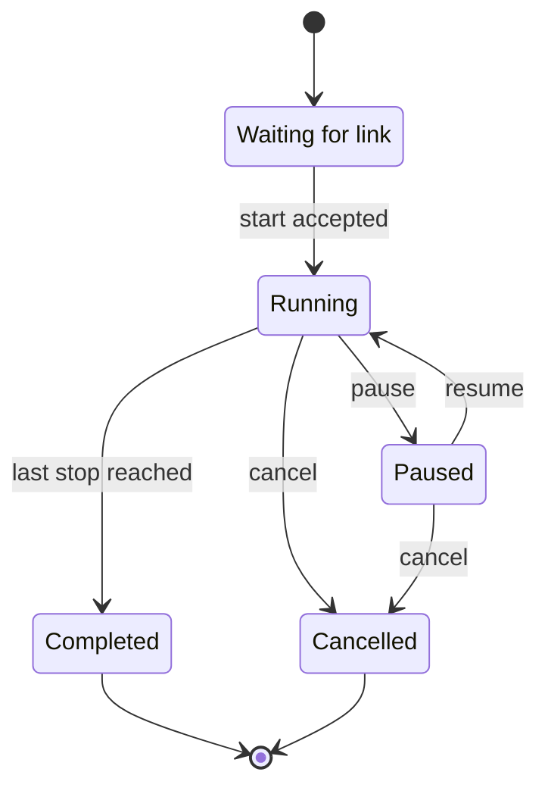
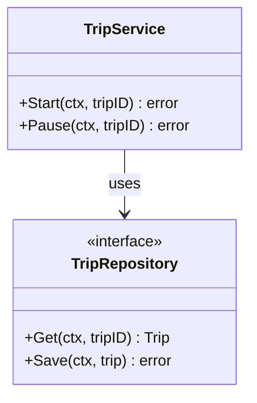

# C4 diagrams in Mermaid

How the design document draws the C4 model. Read it before drawing the first diagram. Every template below has been rendered with mermaid-cli; copy the shape, then replace the content.

## Contents

- The C4 model in brief
- Which diagrams the document needs
- Notation rules
- Templates: notation key, context, container, component, deployment, sequence, data model, state, code
- Mermaid syntax that breaks rendering

## The C4 model in brief

C4 describes a system at four zoom levels, each a diagram for a different reader:

| Level | Diagram | Shows | Reader |
|---|---|---|---|
| 1 | System context | The system as one box, the people who use it, and the systems it talks to | Anyone, technical or not |
| 2 | Container | The separately running or deployable parts inside the system, with their technology | Developers and operators |
| 3 | Component | The parts inside one container, each a grouping of code behind an interface | Developers of that container |
| 4 | Code | The classes or functions inside one component | Rarely worth drawing |

The element types have precise meanings, and the diagrams are only useful if the document keeps to them:

- **Person:** a human role that uses the system.
- **Software system:** the thing being designed, or another system it depends on.
- **Container:** something that has to be running for the system to work: an application, a service, a database, a file store, a queue or topic. It is not a Docker container, although it may be deployed in one.
- **Component:** a grouping of related code inside a container, behind a well-defined interface. It maps to a real unit in the codebase (a package, a module), and it is not separately deployable.
- **Code element:** a class, interface, or function inside a component.

Each level zooms into one box of the level above. A container diagram shows only containers, people, and external systems. A component diagram shows the components of one container, plus the neighbours they talk to. Mixing levels in one diagram is the most common C4 mistake.

## Which diagrams the document needs

| Section | Diagram | How many |
|---|---|---|
| 1.5 How to read the diagrams | Notation key (`flowchart`) | One |
| 2.2 System context | C4 level 1 (`flowchart`) | One |
| 2.3 Containers | C4 level 2 (`flowchart`) | One |
| 2.4 Deployment | Deployment (`flowchart`) | One when containers run on more than one node; otherwise a sentence |
| 3.1 Data model | `erDiagram` | One per store that holds structured data |
| 4.3 Key interactions | `sequenceDiagram` | One per flow that shaped the design: the main success path, and the failure paths that drove a decision |
| 5.x Component design | C4 level 3 (`flowchart`) | One per container with internal structure worth showing. A database, a queue, or a static site usually has none. |
| 5.x Behaviour | `stateDiagram-v2` | One per component whose behaviour is a state machine |
| 5.x Code | C4 level 4 (`classDiagram`) | Only for a component whose internal structure is itself the design problem. An IDE can generate the rest on demand. |
| 6.2 Screens and navigation | `flowchart` | One when there are screens or steps to move between; none for a single command or a configuration file |

A diagram earns its place by showing structure or order that prose would take longer to say. Split a diagram that passes about 15 elements: the reader can no longer take it in, and it usually means two levels have been merged.

## Notation rules

A diagram that needs its author to explain it has failed. These rules are what make one readable alone:

- **Caption.** Directly below each diagram, write `*Figure N. <Diagram type> for <scope>.*`, numbered in order through the document, for example `*Figure 3. Container diagram for Site Manager.*`. The type and scope tell the reader the zoom level. Cite every figure in the text before it appears, as "Figure N", saying what to notice.
- **Element labels.** Three lines: the name, then `[Type: technology]`, then one line saying what it does. Level 1 elements have no technology: `[Person]`, `[Software system]`, `[External system]`.
- **Relationship labels.** A verb phrase from the arrow's tail to its head, with the protocol in brackets when it crosses a process boundary: `"sends trip lists [gRPC]"`. The arrow points the way the call or the dependency goes. Use two arrows rather than one two-headed arrow when both sides initiate.
- **One notation.** The same shape and colour means the same element type in every diagram. The `classDef` lines of the notation key below are the palette: paste the ones a diagram uses at the end of that diagram. A person is a stadium `(["..."])`, a data store is a cylinder `[("...")]`, and everything else is a rectangle `["..."]`.
- **Boundaries.** A dashed subgraph is the edge of the system (level 2) or of the container (level 3). Its title names what it bounds and its type.
- **Deployment nodes.** A solid-bordered subgraph is a place where containers run: a device, a server, a runtime. Its title is `Name [Deployment node: technology]`, nodes nest, and every container sits inside the node it runs on. Arrows still run between containers.
- **Existing and proposed.** When the document describes a change to a system that exists, mark each new or changed element with `class <id> proposed`, which adds a thick dashed orange border, and say so beside the key. A document where everything is new, or everything exists, leaves the marker out.
- **Names.** The name in a diagram is the name in the tables, the prose, and the glossary, letter for letter.
- **Acronyms and technology names** used in a diagram are in the glossary.

## Templates

### Notation key (Figure 1)

Keep only the element types the document uses, and drop the "new or changed" entry unless the document marks proposed elements. If the document has a deployment diagram, add a sentence beside the key: a solid box is a deployment node.

### System context (level 1)

The system in scope is one box. Nothing inside it appears at this level.

### Container (level 2)

Every person and external system from the context diagram reappears here, now connected to the container it actually talks to.

### Component (level 3)

Arrows between components show the direction of dependency. This is where the architecture pattern becomes visible: layers that only point downward, a core with plug-ins around it, ports with adapters behind them.

### Deployment

The containers are the ones in the container diagram, under the same names, each placed on the node it runs on.

### Sequence (key interactions)

Participants are containers or components from the earlier diagrams, under the same names. Use `->>` for a call and `-->>` for its reply.

### Data model

Cardinality reads left to right: `||--o{` is "exactly one to zero or more", `||--|{` is "exactly one to one or more", `}o--o{` is "many to many".

### State

Give a state whose name has spaces an alias, as `waiting` has here.

### Code (level 4, only when warranted)

## Mermaid syntax that breaks rendering

Each of these was confirmed to fail in mermaid-cli. The checker script reports them with a line number, but avoiding them is quicker than fixing them.

- **Quote every flowchart label.** `a["Process (async)"]` renders; `a[Process (async)]` is a parse error, as is any unquoted label containing parentheses or brackets.
- **Quote every edge label.** `-->|"reads/writes [SQL]"|` renders; `-->|reads/writes [SQL]|` does not.
- **Keep reserved words out of node IDs.** A node called `end` breaks the diagram. Use plain IDs such as `api` or `trip_repo`, and put the display name in the label.
- **No semicolons in sequence messages.** `a->>b: SELECT 1; SELECT 2` is a parse error. Reword it or split it into two messages.
- **Quote `erDiagram` attribute comments.** `string name "unique per site"` renders; the same comment without quotes does not.
- **Line breaks in labels are ` `.** It works in every Mermaid version, where `\n` depends on the version.
- **A double quote inside a label is `#quot;`.**
